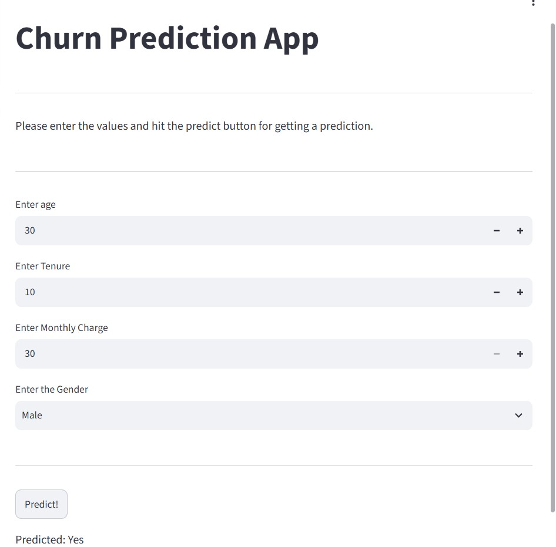

# Customer Churn Analysis and Prediction

## Project Overview
This project uses Machine Learning to predict whether a customer is likely to leave a service (churn). It includes a Streamlit web application where users can enter customer details and receive a churn prediction.

## Objectives
- Analyze customer information related to churn.
- Preprocess customer data for Machine Learning.
- Train and evaluate classification models.
- Build an interactive web application using Streamlit.
- Demonstrate a trained model through a user-friendly interface.

## Technologies Used
- **Python** – Core programming language
- **Pandas** – Data manipulation and analysis
- **NumPy** – Numerical computations
- **Scikit-learn** – Machine Learning preprocessing and prediction
- **Streamlit** – Interactive web application
- **Joblib** – Loading saved model-related files
- **Jupyter Notebook** – Data analysis and model development

## Features
- Accepts customer age, gender, tenure, and monthly charges.
- Applies the saved scaler to input data.
- Uses a trained Machine Learning model to predict customer churn.
- Displays the prediction through an interactive web interface.
- Provides a simple interface for testing customer details.

## Input Features
- Age
- Gender
- Tenure
- Monthly Charges

## Application Screenshot



## Project Structure

```text
Customer-Churn-Analysis-Prediction/
├── app.py
├── customer_churn_dataset.csv
├── model.pkl
├── scaler.pkl
├── notebook.ipynb
├── requirements.txt
├── README.md
└── screensshoots/
    └── Screenshot.jpg
```

*Note: The dataset filename shown above is an example. Replace it with the exact filename in your repository if it differs.*

## How to Run the Project

### 1. Clone the Repository

```bash
git clone https://github.com/varshitharodda/Customer-Churn-Analysis-Prediction.git
cd Customer-Churn-Analysis-Prediction
```

### 2. Install Dependencies

```bash
py -m pip install -r requirements.txt
```

### 3. Run the Streamlit Application

```bash
py -m streamlit run app.py
```

### 4. Open the Application

Open the local URL displayed in the terminal to access the application in your browser.

## Model and Scaler Files
The application requires `model.pkl` and `scaler.pkl` in the project directory. These files contain the saved model and scaler used by the application.

## Future Enhancements
- Add more customer features to improve prediction capabilities.
- Display model evaluation metrics.
- Improve the user interface and prediction insights.
